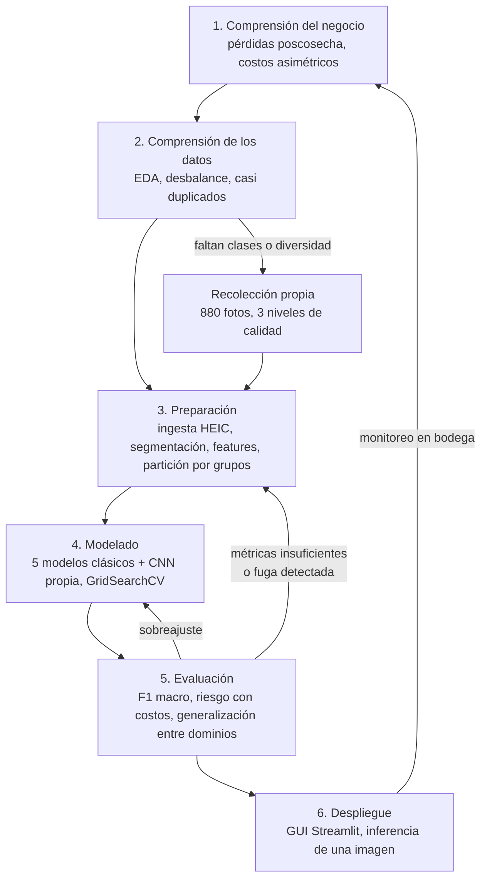

# Metodología: CRISP-DM aplicado al proyecto

> Sustenta el criterio 4 de la rúbrica (*Estrategia de solución y justificación
> técnica*) y la sección 5 del informe final. El enunciado advierte que no basta
> copiar el diagrama genérico: aquí cada fase está instanciada con las
> decisiones, los datos y los comandos reales de este repositorio.
>
> Diagrama de flujo vectorial para el informe: [`figuras/crisp_dm_flujo.svg`](figuras/crisp_dm_flujo.svg)

---

## Visión general del flujo



Los tres bucles de retroalimentación no son decorativos: **los tres se
ejecutaron en este proyecto**. El bucle Evaluación → Preparación se activó al
detectar un 37,8 % de casi duplicados; el bucle Evaluación → Modelado al
detectar circularidad en la tarea de tamaño; el bucle Comprensión de datos →
Recolección al constatar que el dataset público no tiene clase intermedia.

---

## Fase 1. Comprensión del negocio

### 1.1 El problema

En plazas de mercado y centros de acopio la clasificación de fruta se hace a
ojo, por operarios distintos, en turnos distintos y bajo iluminación distinta.
Las consecuencias son tres:

1. **Inconsistencia.** Dos operarios clasifican la misma fruta de forma
   distinta, y el mismo operario cambia de criterio a lo largo del turno.
2. **Pérdida económica.** Fruta buena vendida como de segunda (pérdida de
   margen) y fruta deteriorada enviada al cliente (devoluciones, pérdida de
   confianza, riesgo sanitario).
3. **Desperdicio.** Lotes completos descartados porque no hay tiempo para
   clasificar unidad por unidad.

> **[CITA PENDIENTE]** Cuantificar las pérdidas poscosecha de frutas en
> Colombia con una fuente citable (FAO, DANE o el DNP) y reemplazar este
> marcador. La rúbrica exige explicar el impacto económico con datos, no con
> generalidades.

### 1.2 Objetivo analítico

Construir un clasificador que, a partir de una sola fotografía de una fruta
individual sobre fondo simple, prediga:

- **Calidad** en tres niveles: `good`, `regular`, `bad`.
- **Tamaño** en tres niveles: `pequeño`, `mediano`, `grande`.

### 1.3 Criterios de éxito

| Tipo | Criterio | Umbral acordado | Estado |
|---|---|---|---|
| Negocio | Reducir la inconsistencia entre operarios | Predicción determinista y auditable | Alcanzado por construcción |
| Negocio | Minimizar fruta mala vendida como buena | Falsos `good` sobre `bad` $\le 2\,\%$ del conjunto de prueba | Por verificar en la corrida final |
| ML | Superar con holgura la línea base trivial | $F_1^{\text{macro}} \ge 0{,}80$ frente a $\approx 0{,}31$ del `DummyClassifier` | Alcanzado (0,97) |
| ML | Detectar la clase minoritaria | Recall de `regular` $\ge 0{,}60$ | Por verificar |
| ML | Generalizar al dominio real | Caída de $F_1$ entre Kaggle y fotos propias $\le 0{,}10$ | Por verificar |
| Operativo | Inferencia en CPU | $\le 1$ s por imagen | Por medir en la GUI |

**Por qué estos umbrales y no otros:** el de negocio viene de la matriz de
costos asimétricos (ver `02_formulacion_matematica.md`, §7.2); el de ML se fija
respecto a la línea base medida, no a un número redondo arbitrario; el de
generalización es el que decide si el sistema sirve fuera del laboratorio.

### 1.4 Supuestos y restricciones

- Una sola fruta por imagen, sobre fondo simple y relativamente uniforme.
- Cinco frutas en alcance: manzana, banano, guayaba, lima/limón, naranja.
- Sin GPU: todo debe entrenarse y ejecutarse en CPU.
- El sistema **asiste**, no reemplaza, al operario (ver `03_etica_e_impactos.md`).

---

## Fase 2. Comprensión de los datos

### 2.1 Fuentes

| Fuente | Imágenes | Clases de calidad | Condiciones de captura |
|---|---|---|---|
| Kaggle *Fruit Quality Classification* | 19.526 totales; muestra estratificada de 2.500 | `good`, `bad` | Estudio, fondo uniforme, iluminación controlada |
| Recolección propia del grupo | 880 (862 en alcance) | `good`, `regular`, `bad` | Celulares, plaza de mercado y hogares, fondos e iluminación reales |

Enlace del dataset público:
<https://www.kaggle.com/datasets/ryandpark/fruit-quality-classification>

### 2.2 Hallazgos del análisis exploratorio

1. **El dataset público no tiene clase intermedia.** Solo `Good` y `Bad`,
   mientras el enunciado exige tres o más categorías. La clase `regular`
   proviene íntegramente de la recolección propia (221 imágenes válidas).
2. **Desbalance severo en el dataset original.** `Pomegranate_Good` concentra
   5.940 imágenes, el 30 % del total, y la granada no está en el alcance de
   cinco frutas. Se excluyó de la muestra; de lo contrario habría dominado
   cualquier modelo.
3. **37,8 % de casi duplicados.** Medido con huella perceptual dHash: 1.554
   grupos únicos para 2.500 imágenes. Es el hallazgo metodológicamente más
   importante del proyecto, porque invalida la partición aleatoria.
4. **Formatos heterogéneos en el material propio.** 425 de 880 fotografías en
   HEIC, que OpenCV no lee: `cv2.imread` devuelve `None` y la imagen se
   perdería en silencio. Más 26 archivos sueltos fuera de su subcarpeta, con
   la etiqueta solo en el nombre del archivo, y una carpeta `Orage_Bad` con el
   nombre mal escrito.
5. **Orientación EXIF.** Las fotos de celular guardan la rotación como
   metadato; OpenCV lo ignora y las imágenes verticales entrarían acostadas.
6. **Cambio de dominio evidente.** Las imágenes de Kaggle están sobre fondo
   neutro; las propias tienen manos, mesones de granito, bolsas y sombras. La
   heurística de segmentación por saturación funciona mucho mejor en las
   primeras.
7. **La clase `regular` es minoritaria:** 221 de 3.356 imágenes (6,6 %).

### 2.3 Composición final del dataset consolidado

| Fuente | `good` | `regular` | `bad` | Total |
|---|---|---|---|---|
| kaggle | 1.250 | 0 | 1.250 | 2.500 |
| recolectado | ~402 | ~221 | ~233 | ~856 |
| **Total** | **1.652** | **221** | **1.483** | **3.356** |

*Los conteos exactos de la corrida vigente están en
`data_processed/features/meta.json` y en
`experiments/results/informe_consolidado.md`.*

---

## Fase 3. Preparación de los datos

Cadena completa, en orden de ejecución:

```powershell
python -m src.data.extract_kaggle --zip "C:/ruta/fruits.zip" --per-class 250 --mixed 40
```

```powershell
python -m src.data.ingest_recolectado --zip "C:/ruta/proyectoAPO.zip"
```

```powershell
python -m src.data.build_dataset
```

```powershell
python -m src.features.build_features
```

### 3.1 Decisiones de preparación y su justificación

| Decisión | Alternativa descartada | Por qué |
|---|---|---|
| Muestra estratificada de 250 por carpeta fruta×calidad | Usar las 19.526 imágenes | Permite iterar en CPU conservando el balance; el código escala con `--per-class 0` para la corrida final |
| Excluir granada | Incluirla como sexta clase | 30 % de los datos en una fruta fuera del alcance acordado |
| Excluir granadilla de las fotos propias | Incluirla | Solo 18 imágenes: soporte insuficiente para una clase |
| Convertir HEIC a JPEG | Ignorar los HEIC | Se perderían 425 de 880 fotos propias, casi la mitad del aporte del grupo |
| Aplicar `exif_transpose` y guardar ya rotada | Confiar en el metadato | OpenCV ignora EXIF; se evita que el modelo vea frutas acostadas |
| Redimensionar el lado mayor a 1.024 px | Conservar 12 MP | 1,4 GB → 159 MB sin perder información útil: la CNN trabaja a 128×128 y los descriptores son adimensionales |
| Desambiguar nombres repetidos con sufijo `_dupN` | Sobrescribir | Seis fotos de guayaba se perdían en silencio por colisión de nombres |
| Máscara por saturación + Otsu | Umbral fijo | Se adapta a cada imagen; el piso de 45 evita partir la fruta cuando ocupa casi todo el encuadre |
| Aumentación solo en entrenamiento | Aumentar antes de partir | Aumentar antes de partir mete variantes de la misma imagen en prueba: fuga |
| **Partición por grupos de casi duplicados** | Partición aleatoria estratificada | Con 37,8 % de duplicación, la partición aleatoria infla las métricas |
| Estratificar también por fuente | Estratificar solo por clase | Si una fuente se concentra en una partición, la métrica mide otro dominio |
| Escalado dentro de un `Pipeline` | `StandardScaler` sobre todo el dataset | Ajustar el escalador con datos de prueba es fuga de información |

### 3.2 Protocolo de anotación

Para que `regular` sea una clase reproducible y no una opinión, se adopta esta
definición operativa. **Debe aplicarse igual por los cuatro integrantes.**

| Clase | Criterio observable | Decisión comercial asociada |
|---|---|---|
| `good` | Color uniforme y propio de la madurez de consumo. Sin manchas oscuras. Superficie firme, sin hundimientos. Defectos superficiales $< 5\,\%$ de la superficie visible | Venta de primera |
| `regular` | Entre 5 % y 25 % de la superficie con manchas, pardeamiento, raspones o golpes leves. Deformación o maduración desigual. Sigue siendo comestible | Venta con descuento o procesamiento |
| `bad` | Más del 25 % de la superficie afectada, o presencia de moho, exudado, hundimiento profundo o fermentación | Descarte o compostaje |

**Reglas de desempate:**
1. Ante duda entre dos clases, se asigna la **peor** de las dos (criterio
   conservador: es más costoso vender fruta mala que descartar fruta buena).
2. Si la foto no permite decidir (desenfoque, oclusión, varias frutas), se
   marca como no anotable y se excluye en lugar de adivinar.
3. Cada imagen dudosa la revisan dos integrantes; se registra el desacuerdo.

**Medición de la calidad de la anotación:** anotar 100 imágenes en común entre
dos personas y reportar el $\kappa$ de Cohen entre anotadores. Un $\kappa$
bajo (< 0,6) indica que las definiciones de arriba no son suficientemente
operativas y hay que refinarlas antes de entrenar. *Esta medición está
pendiente y es un requisito para el informe final: sin ella no se puede
afirmar que las etiquetas sean confiables.*

### 3.3 Protocolo de captura (pendiente de aplicar)

Para que la estimación de tamaño sea físicamente válida (ver
`02_formulacion_matematica.md`, §5), las fotos nuevas deben tomarse con:

- Distancia cámara–fruta **fija** (soporte o marca en la mesa), o
- Un **objeto de referencia** de diámetro conocido en el encuadre (una moneda
  de $\$500$ mide 23,7 mm).
- Fondo de color uniforme y contrastante con la fruta.
- Una sola fruta por fotografía, centrada.
- Luz difusa, evitando flash directo y sombras duras.

---

## Fase 4. Modelado

### 4.1 Familias y por qué estas

| Modelo | Por qué se incluye | Hipótesis que pone a prueba |
|---|---|---|
| `DummyClassifier` | Línea base obligatoria | ¿Cuánto se logra sin aprender nada? |
| Regresión logística | Modelo lineal interpretable | ¿Las clases son separables linealmente en el espacio de 93 características? |
| KNN | No paramétrico, sin supuestos de forma | ¿Hay estructura local de vecindad útil? |
| SVM con núcleo RBF | Fronteras no lineales con control de margen | ¿Se gana con una frontera flexible y pocas muestras? |
| Random Forest | Bagging, robusto a escalas y no linealidades | ¿Qué características importan de verdad? |
| Gradient boosting por histogramas | Estado del arte en datos tabulares | ¿Cuál es el techo del enfoque con características diseñadas a mano? |
| CNN propia (3 bloques) | Requisito de deep learning del enunciado | ¿Aprender las características supera a diseñarlas, con solo miles de imágenes? |

`xgboost` se soporta automáticamente si está instalado; si no, el catálogo usa
`HistGradientBoostingClassifier`, que implementa el mismo algoritmo.

### 4.2 Protocolo de ajuste de hiperparámetros

- `GridSearchCV` con **`StratifiedGroupKFold` de 5 pliegues**, pasando los
  identificadores de grupo de casi duplicados.
- Métrica de selección: $F_1$ **macro**, no exactitud.
- Se registran la media y la desviación de los pliegues, y el $F_1$ de
  entrenamiento, para poder reportar la **brecha de generalización**.
- La CNN usa parada temprana sobre el $F_1$ macro de validación con paciencia 8.
- Semilla global fija (`RANDOM_STATE = 42`) en `random`, `numpy` y `torch`.

### 4.3 Ablaciones diseñadas

Los experimentos que permiten afirmar *por qué* funciona, no solo *que*
funciona:

1. **Características enriquecidas (93) frente a la línea inicial (1.028).**
   `--features baseline` reproduce el extractor original del equipo.
2. **CNN con fondo frente a CNN sin fondo** (`--aplicar-mascara`). Si el
   desempeño cae poco al borrar el fondo, el modelo mira la fruta; si cae
   mucho, estaba aprendiendo el fondo del dataset.
3. **Generalización entre dominios.** El mismo modelo evaluado por separado en
   Kaggle y en las fotos propias (`src/evaluation/evaluate.py`).

---

## Fase 5. Evaluación

### 5.1 Qué se reporta y por qué

| Métrica | Pregunta que responde |
|---|---|
| $F_1$ macro | ¿Funciona en todas las clases, incluida la minoritaria? |
| Exactitud balanceada | ¿O solo acierta en la clase mayoritaria? |
| Matriz de confusión normalizada por fila | ¿Qué confunde con qué? |
| Falsos `good` sobre `bad` | ¿Cuántas frutas malas se venderían como buenas? |
| Riesgo con costos asimétricos | ¿Cuánto cuesta el modelo en términos del negocio? |
| $\kappa$ de Cohen y MCC | ¿Hay acuerdo real o es azar? |
| MAE ordinal (tamaño) | ¿Los errores son de un nivel o de dos? |
| Brecha entrenamiento − prueba | ¿Está sobreajustando? |
| $F_1$ por fuente | ¿Generaliza al dominio real de despliegue? |
| $F_1$ por fruta | ¿Falla en alguna fruta en particular? |

### 5.2 Orden de uso de los conjuntos

Entrenamiento (70 %) para ajustar parámetros e hiperparámetros por validación
cruzada → validación (15 %) para **elegir** el modelo → prueba (15 %) **una
sola vez** con el modelo ya elegido. Mirar prueba antes de elegir sesga la
estimación hacia arriba por selección múltiple.

### 5.3 Análisis de errores

`src/training/train_cnn.py` genera una galería con los diez errores más
*confiados* del modelo (los que falló con probabilidad más alta). Revisarlos a
ojo es la única forma de distinguir tres causas distintas que las métricas
confunden: fallo del modelo, etiqueta equivocada y segmentación defectuosa.

---

## Fase 6. Despliegue

### 6.1 Arquitectura prevista

```
Imagen (archivo o cámara)
        │
        ▼
 normalizar (EXIF, RGB, escala)
        │
        ▼
 segmentar  ──► máscara ──► 93 características ──► modelo clásico ──┐
        │                                                            ├─► calidad + tamaño + confianza
        └────► redimensionar 128×128 ──────────────► CNN ───────────┘
```

### 6.2 Pendiente de implementar

- `src/deployment/predict.py`: función `predecir(ruta_o_arreglo) -> dict` que
  reutilice exactamente el mismo preprocesamiento del entrenamiento. **Es
  crítico que comparta el código con `build_features`**: si la GUI
  preprocesa distinto a como se entrenó, el modelo degrada sin aviso
  (*training–serving skew*).
- `src/deployment/app.py`: interfaz Streamlit con carga de archivo y captura
  por cámara (`st.camera_input`), que muestre la clase, la probabilidad y la
  máscara segmentada para que el usuario vea *qué* miró el modelo.
- Mostrar siempre la confianza y un aviso explícito cuando la predicción esté
  por debajo de un umbral, en lugar de dar una respuesta falsamente segura.

### 6.3 Riesgos de despliegue

| Riesgo | Mitigación |
|---|---|
| Fruta fuera de las cinco entrenadas | Detectar baja confianza y responder "no reconocida" |
| Fondo complejo que rompe la segmentación | Mostrar la máscara al usuario; exigir fondo simple en las instrucciones |
| Iluminación muy distinta a la de entrenamiento | Aumentación fotométrica en entrenamiento; recalibración periódica |
| Varias frutas en el encuadre | Validar que haya un solo contorno dominante y avisar |
| Deriva del modelo con el tiempo | Guardar las imágenes evaluadas (con consentimiento) y reentrenar |

---

## Registro de decisiones

| # | Decisión | Fase | Motivo |
|---|---|---|---|
| 1 | Muestra estratificada de Kaggle en lugar del dataset completo | 3 | Iterar en CPU sin perder balance |
| 2 | Excluir granada y granadilla | 2 | Fuera de alcance / soporte insuficiente |
| 3 | Vector de 93 características en lugar de 1.028 | 3 | Razón muestras/dimensiones de 2,4 es insuficiente |
| 4 | Partición por grupos de casi duplicados | 3 | 37,8 % de duplicación medida |
| 5 | Estratificar por fuente además de por clase | 3 | Dos dominios distintos en el mismo dataset |
| 6 | RGB para la CNN, histograma de H para los clásicos | 3 | El canal H es angular: discontinuidad en 0/180 |
| 7 | $F_1$ macro como métrica de selección | 5 | `regular` es el 6,6 % de los datos |
| 8 | Matriz de costos asimétricos | 5 | Vender fruta mala cuesta más que descartar buena |
| 9 | CNN multitarea con $\lambda_s = 0{,}5$ | 4 | Las etiquetas de tamaño son menos confiables |
| 10 | Declarar la circularidad de la tarea de tamaño | 5 | $F_1 = 1{,}000$ es un diagnóstico, no un logro |

---

## Reproducibilidad

```powershell
pip install -r requirements.txt
```

```powershell
python -m src.data.extract_kaggle --zip "C:/ruta/fruits.zip"; python -m src.data.ingest_recolectado --zip "C:/ruta/proyectoAPO.zip"; python -m src.data.build_dataset; python -m src.features.build_features
```

```powershell
python -m src.training.train_classic --task both; python -m src.training.train_cnn; python -m src.evaluation.evaluate
```

Semilla fija en `src/utils/config.py`. Los artefactos quedan en
`experiments/checkpoints` (modelos, ignorados por git) y
`experiments/results` (métricas y figuras, versionados).
